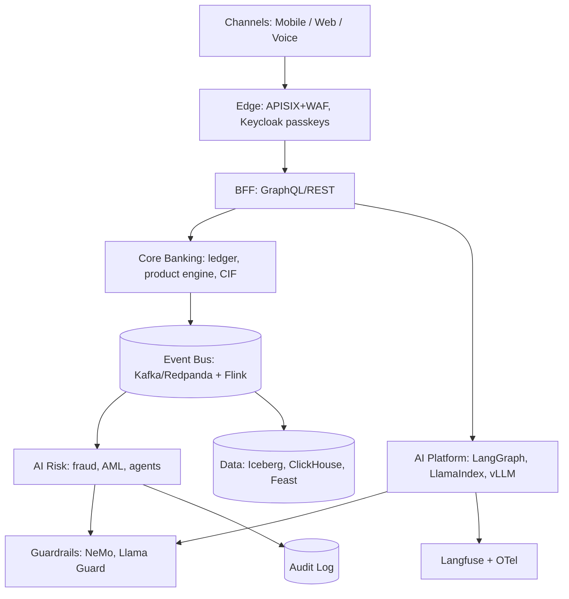

# 13 — High-Level Solution Overview

> **Scope:** all features + AI use cases are in scope per [`in_scope_and_out_of_scope.md`](05_scope_and_boundaries/in_scope_and_out_of_scope.md); out of scope: physical branches, proprietary payment scheme, own core-ledger build.

## Solution in one paragraph

Aegis Bank is an AI-first retail bank built on a bought real-time core, an event-driven backbone, and a Python AI/risk plane. Customers interact through mobile, web, voice, and an agentic assistant; the AI plane powers fraud detection, AML investigation, underwriting support, and service; every AI decision is grounded, guarded, eval-gated, and auditable.

## High-level architecture

## Component responsibilities

| Component | Responsibility |
|---|---|
| **Channels** | Customer & employee interfaces (RN, Next.js, voice, ops console). |
| **Edge & Identity** | Auth (passkeys/MFA), WAF, rate limiting. |
| **BFF** | Aggregates backend calls per client. |
| **Core banking** | System of record: ledger, products, GL, CIF. |
| **Event bus** | Real-time backbone; every txn → event. |
| **AI platform** | Agents, RAG, inference, feature store. |
| **AI risk** | Fraud, AML, compliance intelligence (`aegis/`). |
| **Data** | Lakehouse, warehouse, feature store. |
| **Guardrails** | Fail-closed safety on all AI. |
| **Observability** | Tracing, eval, audit. |

## Why this shape

- **Bought core** = speed + compliance.
- **Event-driven** = real-time AI is possible.
- **Python AI plane** = leverage the best AI ecosystem.
- **Guardrails + audit** = regulator-ready.

See `03_system_and_architecture/` for detailed design.