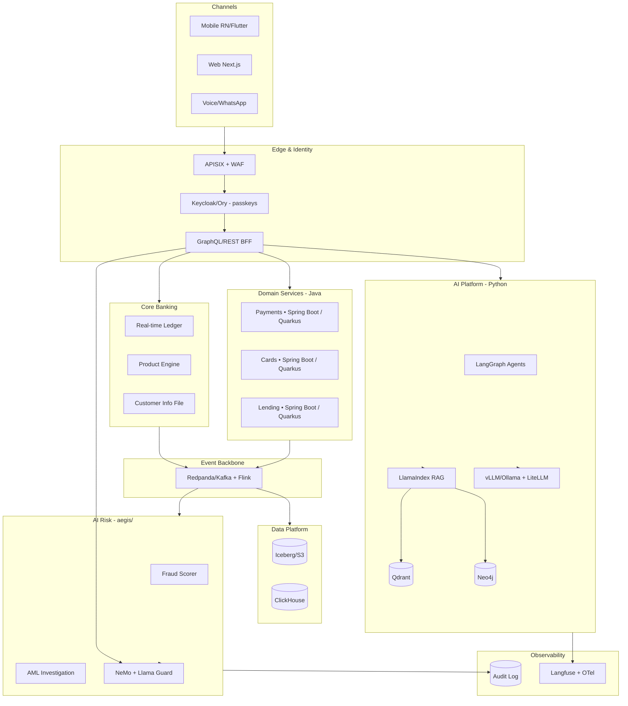

# End-to-End System Architecture

## Context
Aegis is an AI-first retail bank. The architecture separates the **transactional core** (bought) from the **AI/risk plane** (built), connected by an **event backbone**.

## Coverage
This document is the **component/topology view**. The authoritative lists it implements are kept in dedicated sources (not duplicated here):

- **Features (~485, 37 sections):** [`../01_requirements_and_capacity_estimation/07_full_feature_catalog.md`](../01_requirements_and_capacity_estimation/07_full_feature_catalog.md)
- **AI use cases (~46, 7 domains):** [`../01_requirements_and_capacity_estimation/08_ai_use_case_catalog.md`](../01_requirements_and_capacity_estimation/08_ai_use_case_catalog.md)
- **Feature → component traceability:** [`../01_requirements_and_capacity_estimation/06_feature_traceability.md`](../01_requirements_and_capacity_estimation/06_feature_traceability.md)
- **Master index:** [`../../FEATURE_AND_USE_CASE_COVERAGE.md`](../../FEATURE_AND_USE_CASE_COVERAGE.md)

## Diagram

## Component responsibilities

| Component | Responsibility | Serves (feature types / use-case domains) |
|---|---|---|
| **Channels** (Mobile RN/Flutter, Web Next.js, Voice/WhatsApp) | Customer & employee interfaces; WCAG 2.2 AA | LIFE, ACC — all customer-facing journeys |
| **Edge & Identity** (APISIX + WAF, Keycloak/Ory) | TLS, WAF, rate limiting, authn, passkeys, step-up | PLAT, SEC — every request |
| **BFF** (GraphQL/REST) | Session validation, aggregation, channel-specific shaping | LIFE, ACC — all channels |
| **Core Banking** (Ledger, Product Engine, CIF) | Double-entry ledger, config-driven products, customer master | CORE — accounts, deposits, balances |
| **Domain Services** (Java: Payments, Cards, Lending) | Transactional workflows, idempotent writes | PAY, CARD, LEND |
| **Event Backbone** (Redpanda/Kafka + Flink) | Durable events, stream processing, outbox | DATA, PLAT — cross-cutting |
| **AI Platform** (LangGraph, LlamaIndex, Qdrant, Neo4j, vLLM) | Agents, RAG, vector + graph retrieval, inference | AI — servicing, insights, wealth, ops |
| **AI Risk** (`aegis/`: Fraud, AML, Guard) | Real-time fraud scoring, agentic AML, guardrails | SEC, COMP — fraud, KYC/AML |
| **Data Platform** (Iceberg/S3, ClickHouse) | Lakehouse, OLAP, history, reconciliation | DATA — analytics, reporting |
| **Observability** (Langfuse + OTel, Audit Log) | Traces, metrics, immutable audit | PLAT, COMP — every action |

## Feature-type → component

Every feature type is covered by at least one component (full mapping in `06_feature_traceability.md`):

| Type | Count | Primary component |
|---|---|---|
| CORE | 32 | Core Banking + Accounts |
| PAY | 42 | Payments service |
| CARD | 29 | Cards service |
| LEND | 32 | Lending service |
| WEALTH | 43 | Wealth (AI + Data) |
| BIZ | 57 | Business services |
| SEC | 32 | Fraud + Identity (`aegis/`) |
| AI | 44 | AI Platform (`aegis/`) |
| DATA | 45 | Data Platform |
| OPEN | 7 | Open Banking |
| LIFE | 39 | Lifestyle / Channels |
| ESG | 16 | ESG |
| COMP | 25 | Compliance (`aegis/`) |
| ACC | 12 | Channels (WCAG 2.2 AA) |
| PLAT | 25 | Platform / Data / Infra |

## AI use-case domain → component

The ~46 AI use cases (7 domains) map onto the AI plane as follows (detail in `08_ai_use_case_catalog.md`):

| AI domain | Primary components |
|---|---|
| Personalisation & insights | AI Platform (RAG + agents) + Data Platform |
| Customer servicing | AI Platform (assistant agents) + BFF + Guard |
| Fraud & financial crime | AI Risk (Fraud Scorer) + Neo4j graph + Qdrant |
| Compliance (KYC/AML) | AI Risk (AML) + Guard + Audit Log |
| Wealth & product | AI Platform + Data Platform + Core Product Engine |
| Payments & money movement | Payments service + AI Risk (fraud) + payment agent |
| Ops & engineering | AI Platform (ops agents) + Observability + Data |

## Data flows

### Payment
1. Customer initiates payment (mobile).
2. BFF validates session (passkey) → calls Payments service (Java).
3. Fraud scorer (GNN/GBM) scores in <150ms.
4. If clear → core ledger posts; event emitted to Kafka.
5. If ambiguous → warm-path agent (LangGraph) produces verdict → HITL if needed.
6. Every step → Langfuse trace + audit event.

### Onboarding (KYC)
1. Customer submits ID + liveness (mobile).
2. BFF → Core CIF creates draft; KYC service runs sanctions/PEP/identity checks.
3. AI Risk AML screens; Guard blocks injection/leakage.
4. Verified → account activated; audit event written.

### AML investigation
1. Kafka emits a transaction-monitoring alert.
2. AI Risk AML agent (LangGraph) gathers evidence (graph + RAG) and drafts a narrative.
3. QA reviewer scores confidence (<0.85 → HITL).
4. Analyst approves/files SAR; every step audited.

### Assistant / servicing
1. Customer asks the assistant (chat/voice).
2. BFF → AI Platform agent plans, calls MCP tools (scoped, least privilege).
3. Guard checks input/output/tool calls; high-value actions require step-up + HITL.
4. Resolved or escalated to a human with full context.

## Key principles
- **Event-driven** — core and services emit events; AI/risk and data consume them.
- **AI as first-class** — the AI/risk plane is a peer of the transactional core, not an add-on.
- **Fail-closed guardrails** — safety over availability for AI actions.
- **Audit-ready** — every action produces an immutable audit event.
- **Buy the core, build the moat** — ledger/product engine bought; AI/risk built.