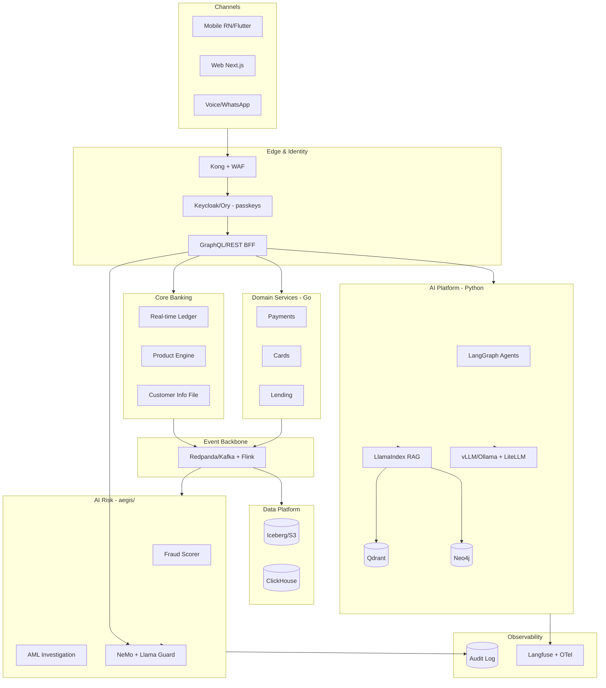

# End-to-End System Architecture

## Context
Aegis is an AI-first retail bank. The architecture separates the **transactional core** (bought) from the **AI/risk plane** (built), connected by an **event backbone**.

## Diagram

## Data flow (payment)

1. Customer initiates payment (mobile).
2. BFF validates session (passkey) → calls Payments service (Go).
3. Fraud scorer (GNN/GBM) scores in <150ms.
4. If clear → core ledger posts; event emitted to Kafka.
5. If ambiguous → warm-path agent (LangGraph) produces verdict → HITL if needed.
6. Every step → Langfuse trace + audit event.

## Key principles
- Event-driven; AI as first-class; fail-closed guardrails; audit-ready.