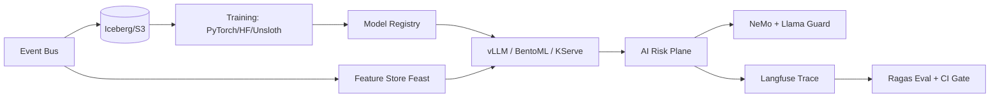

# AI and ML Integration Pipeline

## Pipeline

## Components

| Stage | Tool | Purpose |
|---|---|---|
| **Ingestion** | Kafka + Flink | Stream txn/behaviour events |
| **Features** | Feast | Online/offline parity |
| **Training** | PyTorch, HF, Unsloth (LoRA) | Fraud GNN, credit, classifiers |
| **Registry** | MLflow | Version models |
| **Serving** | vLLM (LLM), BentoML/KServe (ML) | Low-latency inference |
| **Orchestration** | LangGraph + Temporal | Agents, HITL |
| **RAG** | LlamaIndex + Qdrant + Neo4j | Retrieval, GraphRAG |
| **Guardrails** | NeMo + Llama Guard | Fail-closed safety |
| **Eval** | Ragas + Braintrust | Quality gates |
| **Tracing** | Langfuse + OTel | Observability |

## Two-pass structured output

Where an agent must both act and emit strict JSON: pass 1 (tools on, no schema) → pass 2 (tools off, schema on) to avoid constraint-tax tool suppression.

## Human-in-the-loop

High-consequence actions (SAR, freeze, loan approval) pause via LangGraph `interrupt()` / Temporal, resuming after human approval.

## Model routing

LiteLLM gateway routes tiers (fast/balanced/reasoning) to vLLM/Ollama/frontier; budgets enforced per step.