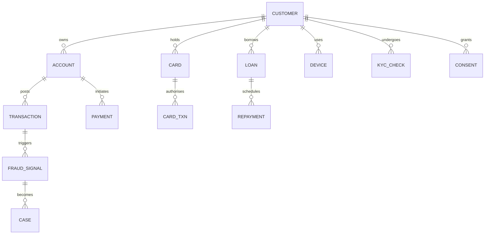

# Database Schemas and ERD

## Core entities

## Key tables (Postgres)

| Table | Purpose |
|---|---|
| `customers` | CIF: identity, risk, status |
| `accounts` | Account balances, product refs |
| `transactions` | Double-entry postings |
| `cards` | Card metadata, status, controls |
| `payments` | Payment instructions, status |
| `loans` | Loan agreements, terms |
| `kyc_checks` | KYC outcomes, evidence |
| `consents` | Open-banking consent lifecycle |
| `audit_events` | Immutable decision log |
| `documents` | pgvector-embedded docs |

## Schemas by store

- **Postgres:** transactional + audit.
- **Qdrant:** embeddings (payload metadata: source, case_id, tenant).
- **Neo4j:** entity graph (temporal validity).
- **ClickHouse:** analytical events.
- **Iceberg:** lakehouse tables (time-travel).