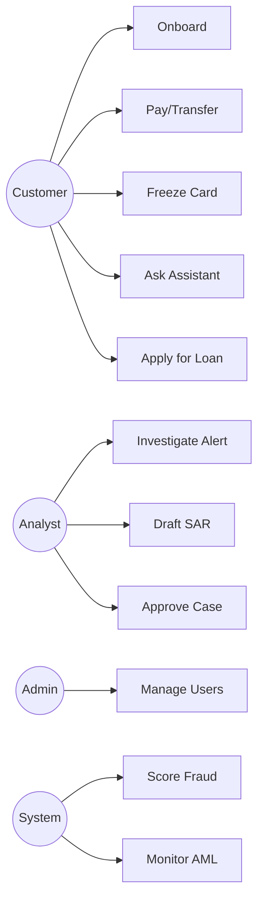

# UML Modeling and System Use Cases

## Use case diagram (text)

## Key use cases

| ID | Use case | Actors | Outcome |
|---|---|---|---|
| UC-1 | Onboard | Customer, System | Account opened, KYC verified |
| UC-2 | Make payment | Customer, System | Payment settled |
| UC-3 | Freeze card | Customer | Card blocked |
| UC-4 | Ask assistant | Customer, AI | Answer or escalation |
| UC-5 | Apply for loan | Customer, System | Decision (auto or human) |
| UC-6 | Investigate alert | Analyst, AI | Case built |
| UC-7 | Draft SAR | Analyst, AI | Narrative ready for filing |
| UC-8 | Approve case | Analyst | Case approved/filed |

## System boundaries

- **Customer-facing** use cases are real-time.
- **Analyst-facing** use cases are async, HITL-gated.
- **System** use cases are event-driven.