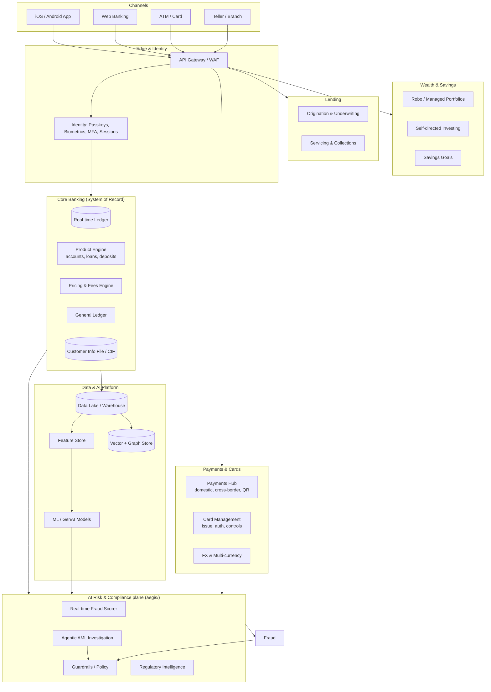
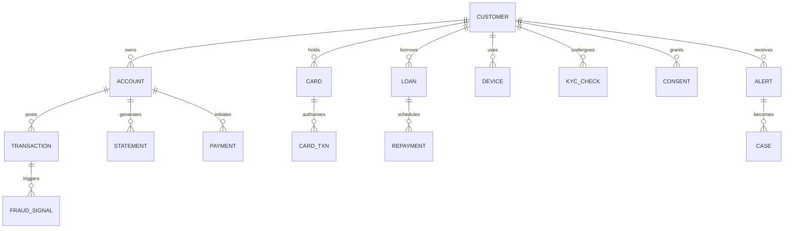
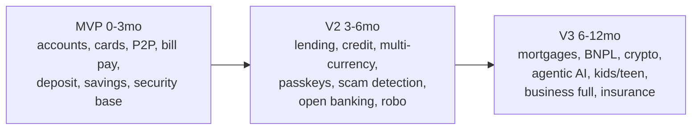

# Aegis Bank — Retail Digital Banking Platform: Product & Architecture Documentation

**Version:** 1.0 · **Date:** 24 November 2026 · **Status:** Product/Architecture specification

This document is the master specification for a full-featured retail digital bank. It is derived from a teardown of the 2026 market — top US incumbents (Chase, Bank of America, Wells Fargo, Capital One, US Bank, SoFi), global digital leaders (DBS — *World's Best Digital Bank 2026*, Global Finance; Nubank — 125M+ customers; Revolut — 70M+; Monzo; Starling; Chime), core-banking platforms (Temenos, Oracle FLEXCUBE, TCS BaNCS, SAP Fioneer, 10x Banking), and the 2026 security / open-banking / accessibility landscape (Ostorlab 2,686-app scan; PSD2/PSD3; European Accessibility Act; WCAG 2.2 AA).

> **Companion code:** the `aegis/` package in this repository implements the **AI-native risk & compliance** plane that underpins this bank (real-time fraud, agentic AML investigation, regulatory intelligence, guardrails). This document describes the full product surface; the code covers the intelligence layer.

---

## 0. Research basis — what the best banks actually ship (2026)

| Source | Key takeaway for the feature set |
|---|---|
| **J.D. Power 2026 Digital Banking Study** | Chase (730) > Wells Fargo (728) > BofA (727) on mobile satisfaction. Only **28% use virtual assistants**, and satisfaction *drops* for fraud/disputes → AI must escalate to humans, not trap users in self-service loops. |
| **11:FS Pulse 2026 (US mobile ranking)** | US Bank 94/100, SoFi 92, BofA 90, Chase 89, Navy Federal 86. Breadth + quality of *in-app* journeys decides rank. |
| **Forbes / CNBC / Investopedia 2026** | Table-stakes features: bill pay, ATM locator, early direct deposit, Zelle/P2P, mobile check deposit, card lock, credit-score monitoring, virtual assistant, budgeting. |
| **Ostorlab 2026 (2,686 apps scanned)** | Only **12%** of banking apps ship in-app fraud detection; **5%** offer passkeys; **17%** a scam warning. Card controls & virtual cards are 5–6× more common in neobanks than incumbents. → large security whitespace. |
| **DBS (World's Best Digital Bank 2026)** | Agentic AI (DBS Joy, digibot) serving 10M+ users; GenAI document extraction (65k forms/mo, –70% effort); tokenised deposits (~SGD 10bn); QR interoperability (PayLah!, Alipay+/Weixin); wealth (digiWealth, 1.5M users). |
| **Nubank** | 125M+ customers, full banking licences (BR/MX/CO), no-fee credit + accounts + loans + insurance + investments. Credit-led, mobile-first onboarding. |
| **Revolut** | 40+ countries, multi-currency, trading, crypto, insurance, Kids/Teens, business. Breadth over depth. |
| **Monzo / Starling** | Pots/Spaces, salary sorting, instant freeze, joint/teen accounts; Starling strong on **business banking** + accounting integrations + MTD. |
| **Chime** | US fee-free, early direct deposit (–2 days), SpotMe overdraft, credit-building, 47k+ fee-free ATMs. |
| **PSD2 / open banking** | Account aggregation (1,800–3,400+ institutions), payment initiation, consent management. |
| **European Accessibility Act / WCAG 2.2 AA** | Accessibility is now a legal requirement for banking apps in the EU; NatWest, CommBank, Starling target WCAG 2.2 AA. |

**Design principles derived from the research:**

1. **Breadth as a moat, but depth where it matters** — match the "all-in-one" surface (payments, cards, lending, savings, invest, business, kids) without shipping 300 half-baked features.
2. **Security is the #1 whitespace** — passkeys, in-app scam detection, behavioural biometrics, card controls, real-time alerts (only 5–17% of apps have these).
3. **AI that escalates, not deflects** — virtual assistants must hand off to humans for fraud/disputes (J.D. Power finding).
4. **Accessibility & compliance by design** — WCAG 2.2 AA, EAA, PSD2/PSD3, GDPR.
5. **One ledger, many products** — core banking is a real-time ledger + product engine + payments + cards + lending.

---

## 1. Personas & jobs-to-be-done

| Persona | Primary jobs |
|---|---|
| **Everyday Retail** | Get paid, spend, pay bills, send money, budget, save, build credit |
| **Saver / Goal-setter** | Automate savings, earn interest, reach goals |
| **Borrower** | Personal loan, auto, mortgage, BNPL, overdraft |
| **Investor (self-directed)** | Trade stocks/ETFs/crypto, track portfolio |
| **Investor (hands-off)** | Robo-advisor, auto-rebalance, retirement |
| **Small Business / Sole Trader** | Business account, invoicing, expenses, payroll, tax (MTD) |
| **Parent / Teen** | Kids/teen accounts, allowances, controls |
| **Traveller / Expat** | Multi-currency, low-FX, global QR, travel insurance |
| **Vulnerable / Accessibility** | Screen-reader, motor, cognitive support; WCAG 2.2 AA |

---

## 2. Feature catalogue (all modules)

Legend: **[T] table-stakes** (must-have), **[D] differentiator**, **[A] AI-native**, **[C] compliance/regulatory**.

### 2.1 Accounts & Deposits
- Checking / current accounts **[T]**
- Savings accounts (instant-access, notice, fixed/term deposits) **[T]**
- Joint accounts **[T]**
- Multi-currency accounts & wallets **[D]**
- Pots / Spaces / sub-accounts for budgeting & goals **[D]**
- Round-ups to savings **[D]**
- Salary sorting (auto-distribute pay) **[D]**
- Sweep / auto-save rules **[D]**
- Term deposits with guaranteed rates **[T]**
- Account opening & KYC (digital onboarding, video ID) **[T][C]**
- Beneficiary / payee management **[T]**

### 2.2 Payments & Transfers
- Domestic transfers (ACH/FPS/SEPA/ Faster Payments) **[T]**
- P2P (Zelle-style) **[T]**
- International transfers / multi-currency FX **[D]**
- Wire transfers **[T]**
- Standing orders & recurring payments **[T]**
- Scheduled & future-dated payments **[T]**
- Request-to-pay / payment requests **[D]**
- QR payments (domestic + cross-border interoperable, e.g. Alipay+/PromptPay/DuitNow) **[D]**
- Cross-border QR & travel card (zero-FX) **[D]**
- RTP / instant payments / FedNow **[T][C]**
- Confirmation of Payee (name check) **[D]**
- Payment approval with per-payment signing **[T]**

### 2.3 Cards
- Physical debit & credit cards **[T]**
- Virtual & single-use/disposable cards **[D]**
- Instant freeze/unfreeze **[T]**
- Granular controls: online, contactless, ATM, international, MCC limits **[T]**
- Spend notifications (real-time) **[T]**
- PIN view, card replacement, add to wallet (Apple/Google Pay) **[T]**
- Travel mode / location-based controls **[D]**
- Card-linked offers & cashback **[D]**
- Credit building (secured card, no credit history) **[D]**

### 2.4 Bill Pay & Payments Management
- Bill pay / biller directory **[T]**
- Scheduled & autopay **[T]**
- Bill reminders & alerts **[T]**
- Subscription manager (detect & cancel) **[D]**
- Split bills / shared tabs **[D]**
- Mobile top-up & airtime **[D]**
- Deposit checks (mobile capture) **[T]**

### 2.5 Transfers Between Own Accounts
- Instant internal transfers **[T]**
- Auto-transfer rules **[D]**

### 2.6 Lending & Credit
- Personal loans (instant decision, fixed/instalment) **[T]**
- Auto / vehicle loans **[T]**
- Mortgages (fixed, variable, offset, tracker; application + servicing) **[T]**
- Student / education loans **[T]**
- Overdraft (arranged + SpotMe-style fee-free buffer) **[D]**
- Buy Now Pay Later / pay-in-four (payday-aligned) **[D]**
- Credit line / earned wage access (EWA) **[D]**
- Loan origination workflow (apply → offer → approve → disburse) **[T][C]**
- Repayment scheduling, delinquency management **[T]**

### 2.7 Savings & Wealth
- Savings goals & targets **[T]**
- Interest-bearing accounts (APY/AER) **[T]**
- Robo-advisor / managed portfolios (ETFs, auto-rebalance) **[D]**
- Self-directed investing (stocks, ETFs, fractional shares) **[D]**
- Retirement accounts (IRA/401k/pension) **[D]**
- Crypto trading (buy/sell/hold) **[D]**
- Portfolio analytics & health score **[A]**
- Wealth projection & scenario comparison **[A]**
- Round-up investing **[D]**
- Financial planning tools (retirement, goals) **[D]**

### 2.8 Money Management & Insights
- Spending dashboard & categorisation **[T]**
- Budgets by category **[T]**
- Cash-flow forecasting **[D]**
- Net-worth / 360° view (incl. external accounts) **[D]**
- Insights & personalised nudges **[A]**
- Financial education content **[D]**
- Gamified savings challenges **[D]**

### 2.9 Credit & Financial Health
- Credit score monitoring (FICO/score) **[T]**
- Credit report & history **[D]**
- Identity-theft / dark-web monitoring **[D]**
- Credit-building tools **[D]**

### 2.10 Security & Fraud (major whitespace)
- Biometric login (fingerprint/Face ID/voice) **[T]**
- Passkeys / FIDO2 **[D]** (only 5% of apps)
- MFA / risk-adaptive authentication **[T]**
- Behavioural biometrics (continuous auth) **[A]**
- Real-time AI fraud detection & scoring **[A]**
- Instant fraud alerts + one-tap card freeze **[T]**
- In-app scam warning / scam-call detection **[A]** (only 17% of apps)
- Malware/overlay/screen-share detection **[A]**
- Device binding / trusted-device management **[T]**
- Per-payment signing (each payment cryptographically approved) **[T]**
- Geo-blocking & travel notices **[D]**
- Consent & data-access transparency (who sees your data) **[D]**
- Privacy controls & data export/delete **[C]**

### 2.11 Customer Service & AI
- Virtual assistant / conversational AI **[T]**
- Agentic assistant (fulfils tasks in one conversation) **[A]** (DBS Joy model)
- Live chat & human escalation (fraud/disputes) **[T]** (J.D. Power: must escalate)
- Co-browsing / screen-share support **[D]**
- In-app secure messaging **[T]**
- Appointment booking (branch/video) **[T]**
- Complaints & dispute management **[T][C]**

### 2.12 Business Banking
- Business current accounts (sole trader / SME) **[D]**
- Multi-user access & team permissions **[D]**
- Invoicing & payment requests **[D]**
- Expense management & receipt capture **[D]**
- Accounting integrations (Xero, QuickBooks, FreeAgent) **[D]**
- Payroll **[D]**
- Tax compliance (Making Tax Digital) **[C]**
- Cash-flow forecasting & bulk payments **[D]**

### 2.13 Kids, Teens & Family
- Teen accounts (16+) with parental controls **[D]**
- Kids' cards & allowances **[D]**
- Spending limits, spend alerts, freeze (parental) **[D]**
- Family plans / shared pots **[D]**

### 2.14 Open Banking & Ecosystem
- Account aggregation (external accounts) **[D]**
- Payment initiation (PISP) **[D]**
- Consent management (grant/revoke/expiry) **[C]**
- Third-party app marketplace **[D]**
- Embedded finance / Banking-as-a-Service **[D]**
- QR / network interoperability **[D]**

### 2.15 Rewards & Loyalty
- Cashback & rewards **[D]**
- Card-linked offers **[D]**
- Referral programmes **[D]**
- Tiered plans (free/premium/metal) **[D]**

### 2.16 Insurance & Protection
- Travel insurance **[D]**
- Device / purchase protection **[D]**
- Life / income protection **[D]**

### 2.17 Accessibility & Inclusion **[C]**
- WCAG 2.2 AA conformance **[C]**
- Screen-reader support (VoiceOver/TalkBack) **[C]**
- Keyboard navigation, focus order, contrast ≥4.5:1 **[C]**
- Adjustable text size / spacing, up to 400% zoom **[C]**
- Plain-language (CEFR B2) content **[C]**
- Multi-sensory info (text + audio), captions **[C]**
- Accessible statements (tagged PDFs) **[C]**
- Support adjustments (sign-language, braille, extra time) **[C]**

### 2.18 Regulatory & Compliance (back-office) **[C]**
- KYC / KYB / CDD & periodic review **[C]**
- Sanctions & PEP screening **[C]**
- AML transaction monitoring & SAR filing **[C]** *(implemented in `aegis/`)*
- Fraud case management **[C]**
- Regulatory reporting (FinCEN, FATF, local) **[C]**
- Audit trail & immutable logging **[C]**
- Data residency & GDPR/CCPA **[C]**

---

## 3. Feature priority matrix

| Tier | Modules | Rationale |
|---|---|---|
| **MVP (0–3 mo)** | Accounts, cards (physical+virtual, freeze, controls), payments (domestic+P2P), bill pay, mobile deposit, savings, budgeting, biometric login, MFA, PIN/OTP, statements, notifications, basic virtual assistant, WCAG AA baseline | Table-stakes; matches CNBC/Forbes "essentials" and gets a usable bank live. |
| **V2 (3–6 mo)** | Lending (personal, overdraft), credit score, multi-currency, pots/salary-sort, robo-advisor, open banking (aggregation), passkeys, in-app scam detection, card-linked offers, business lite | Differentiators (Monzo/Revolut/Starling) + security whitespace (Ostorlab). |
| **V3 (6–12 mo)** | Mortgages, BNPL, crypto, wealth projection, agentic assistant, kids/teen, business full (payroll/MTD), insurance, marketplace, embedded finance/BaaS | Deepens moat (Revolut/DBS/Nubank surface). |

---

## 4. System architecture

### 4.1 Core banking model
- **One ledger, many products** (TCS BaNCS / Temenos pattern): a single real-time, multi-currency ledger with a product engine that configures accounts, loans, deposits, fees, and pricing rather than hard-coding them. New products = configuration + testing, not code.
- **Channels → Gateway → Core** via published REST APIs (ISO 20022, Open Banking).
- **Event-driven**: every transaction emits an event to the data platform (10x Banking pattern) → real-time fraud, AML, analytics.

---

## 5. Data model (core entities)

Key entities: **Customer (CIF)**, **Account**, **Card**, **Loan**, **Transaction**, **Payment**, **Consent**, **KYC Check**, **Alert**, **Fraud Case**, **Device**, **Goal/Pot**, **Portfolio**, **Investment**.

---

## 6. Security architecture

| Layer | Controls |
|---|---|
| **Authentication** | Passkeys (FIDO2) → biometrics (Face/Touch/Voice) → risk-adaptive MFA → OTP fallback. Device binding (key in secure enclave, Play Integrity / App Attest). |
| **Authorisation** | Per-payment signing, granular scopes, step-up auth for high-risk actions. |
| **Fraud** | Real-time scoring (hot path <150ms), behavioural biometrics, in-app scam warnings, device/geo signals, graph (device farms, mule rings). |
| **Data** | Encryption at rest/in transit, tokenisation, field-level protection, data-residency. |
| **Privacy** | Consent management, data-access transparency, export/delete (GDPR/CCPA). |
| **Compliance** | KYC/KYB, sanctions/PEP, AML monitoring + SAR, audit trail, regulatory reporting. |

> Only **5%** of 2026 banking apps ship passkeys and **12%** in-app fraud detection (Ostorlab) → implementing these is a competitive edge.

---

## 7. AI & ML layer

| Capability | Where | Model / pattern |
|---|---|---|
| Real-time fraud scoring | Payments hot path | GNN + gradient-boosted, <150ms, precomputed graph embeddings |
| Agentic fraud investigation | Warm path | LangGraph + LLM, evidence gathering, grounded rationale |
| AML investigation & SAR | Compliance | Multi-agent (supervisor + specialists), GraphRAG, HITL |
| Virtual assistant | All channels | LLM + tools (MCP), agentic fulfilment, human escalation |
| Credit underwriting | Lending | ML risk models + explainability |
| Personalised insights | Money mgmt | Behavioural analytics + GenAI nudges |
| Document processing | Ops | Vision + LLM extraction (DBS: 65k forms/mo, –70% effort) |
| Regulatory change | Compliance | GraphRAG over obligations + controls, gap analysis |
| Scam detection | Security | Vision/NLP on screenshots, call/screen-share signals |

**Guardrails everywhere:** deterministic-first, fail-closed, least-privilege tool access, citation-required generation, human sign-off on high-consequence actions.

> The full AI use-case surface — ~50 use cases across 7 domains, classified by agent archetype with value/readiness/regulatory tags and a prioritised build order — is in [`../01-ai-and-architecture/02-ai-use-case-catalog.md`](../01-ai-and-architecture/02-ai-use-case-catalog.md).

---

## 8. Non-functional requirements

| Area | Target |
|---|---|
| **Availability** | 99.95%+ (24/7, zero-downtime deploys) |
| **Latency** | Balance <200ms; payments hot-path decision <150ms; app cold start <2s |
| **Scale** | Millions of users, 10k+ TPS peak, multi-region |
| **Security** | PCI-DSS, SOC 2, ISO 27001; annual pen-test & red-team |
| **Accessibility** | WCAG 2.2 AA; EAA (EU) compliance; screen-reader tested |
| **Compliance** | GDPR/CCPA, PSD2/PSD3, AML/KYC, local banking regs |
| **Observability** | End-to-end OTel tracing, audit logging, SLO dashboards |
| **Privacy** | Data residency, consent, minimal collection |

---

## 9. Delivery roadmap

**Team topology (suggested):** Core Banking · Payments · Cards · Lending · Wealth · Security/Fraud · Data/AI · Channels (mobile/web) · Platform/SRE · Compliance.

---

## 10. Competitive positioning

| Bank type | Strengths to match | Gaps to exploit |
|---|---|---|
| **Chase / BofA / Wells Fargo** | Polished apps, Zelle, credit monitoring, Erica/Fargo assistants | Slow fraud escalation, limited in-app scam detection, no passkeys |
| **Revolut** | Multi-currency, breadth, travel | Complex fees, inconsistent support, entity-dependent protection |
| **Monzo / Starling** | Pots, budgeting, business, profitability | UK-only, limited multi-currency |
| **Nubank** | Credit-led, LatAm scale, low fees | Regional |
| **Chime** | Fee-free, early pay, credit building | US-only, narrow product range |
| **DBS** | Agentic AI, QR interoperability, tokenised deposits | Asia-centric |

**Aegis Bank's wedge:** incumbent-grade trust + neobank-grade UX + best-in-class security (passkeys, in-app scam detection, real-time fraud) + agentic AI that escalates to humans + full accessibility compliance.

---

## 11. Open questions / next steps

1. **Licensing & jurisdiction** — own bank licence vs BaaS/partner-bank model (determines deposit insurance, KYC, regulator).
2. **Core build vs buy** — build on a ledger product engine vs license Temenos/10x/Oracle.
3. **MVP scope confirmation** — which 3 modules launch first.
4. **Compliance mapping** — target markets (US/UK/EU) → specific regulations (Reg E, PSD2/3, FCA, EAA).

---

*End of document. Companion implementation of the AI risk/compliance plane is in the `aegis/` package.*